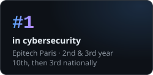
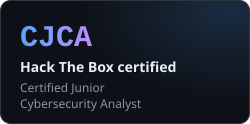
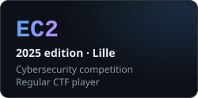

  

  
  &nbsp;
  

- 🚀 Co-founder of **[Seeklon](https://github.com/Seeklon)**, in charge of the production infrastructure
- 🔐 Into DevOps, infrastructure as code, Kubernetes and cybersecurity (CTFs, pentesting)
- 🌏 Spent 2025–26 on exchange at **Inha University** (Incheon, South Korea)
- 💼 Looking for a 5–6 month end-of-studies internship starting **March 2027**, ideally in DevOps, infra or security, but open to exploring other fields

### 🛠️ Tech stack

  

### 🏆 Cybersecurity

  
  
  

### 🧑‍💻 Experience

- **Angardia** · AI & Full-Stack developer intern · *Sep 2026 – now*
- **Framatome** · Log-monitoring tooling intern · *Apr – Jul 2025*
- **Le Donjon de Paris** · Electronics & web intern · *Jul – Nov 2023*
